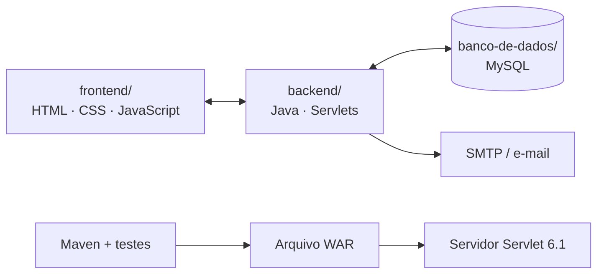

# Aprimore Educação

Plataforma web de apoio à aprendizagem, criada para aproximar estudantes e educadores e facilitar a organização das atividades escolares.

> **Situação atual:** a versão principal do repositório já usa Java 25, Jakarta Servlet 6.1, MySQL/JDBC, HTML, CSS e JavaScript puro. A compilação e os testes automatizados passaram antes da mesclagem; a versão principal está sendo validada novamente. O sistema ainda precisa de testes integrados com banco de dados e servidor antes de ser considerado pronto para produção.

## Tecnologias utilizadas

- **Java 25:** regras e processamento no servidor.
- **Jakarta Servlet 6.1:** recebe as requisições HTTP e encaminha cada operação.
- **JDBC + MySQL 8+:** comunicação com o banco de dados.
- **HTML5, CSS3 e JavaScript puro:** páginas, aparência e interações do navegador.
- **Maven:** organiza as dependências, executa os testes e gera o arquivo WAR.
- **JUnit:** testes automatizados do código Java.

O frontend usa arquivos HTML, CSS e JavaScript separados, sem framework de interface. As bibliotecas declaradas no Maven são dependências do backend, não novas linguagens de programação.

## Mapa visual do projeto

Se você está começando, abra primeiro o **[Mapa visual da arquitetura](documentacao/MAPA_VISUAL_DO_PROJETO.md)**. Ele mostra como as partes se conectam, por onde uma requisição passa e qual arquivo editar para cada tipo de mudança.



### Estrutura de pastas

```text
aprimore7.0/
├── frontend/                O que aparece no navegador
│   ├── index.html           Login, cadastro e recuperação de acesso
│   ├── dashboard.html       Painel após autenticação
│   └── assets/
│       ├── css/style.css    Aparência, layout e responsividade
│       └── js/
│           ├── app.js       Interações da autenticação
│           ├── dashboard.js Ações e dados do painel
│           ├── jogos.js     Jogos educativos e pontuação
│           └── recursos.js  Calendário, avisos e acessibilidade
├── backend/                 O que é executado no servidor
│   ├── src/main/java/       Código Java da aplicação
│   ├── src/test/java/       Testes automatizados
│   ├── src/main/webapp/     Configuração web
│   ├── pom.xml              Dependências, testes e empacotamento
│   └── README.md            Mapa do backend
├── banco-de-dados/          Estrutura e configuração inicial do MySQL
│   ├── schema.sql           Tabelas, relacionamentos e índices
│   ├── usuario-aplicacao.sql Exemplo de permissões limitadas
│   └── README.md            Guia para alterações no banco
├── documentacao/            Mapas, guias e plano de evolução
├── .github/workflows/       Compilação e verificações automáticas
├── .env.example             Nomes das configurações de ambiente
└── README.md                Ponto de entrada do projeto
```

### Documentação por objetivo

- **[Mapa visual da arquitetura](documentacao/MAPA_VISUAL_DO_PROJETO.md)** — diagramas, responsabilidades e fluxo de requisições.
- **[Guia para iniciantes](documentacao/GUIA_DO_PROJETO.md)** — como encontrar e alterar cada parte.
- **[Plano de evolução](documentacao/PLANO_DE_EVOLUCAO.md)** — melhorias priorizadas e critérios de conclusão.
- **[Índice da documentação](documentacao/README.md)** — acesso rápido aos materiais.
- **[Guia do frontend](frontend/README.md)** — páginas, estilos e scripts.
- **[Guia do backend](backend/README.md)** — Servlets, serviços, DAO e testes.
- **[Guia do banco](banco-de-dados/README.md)** — tabelas, relacionamentos e cuidados.

## Funcionalidades presentes na versão principal

- Cadastro de estudantes, login, logout e recuperação de senha por e-mail.
- Senhas armazenadas com hash BCrypt, sessões HTTP e limite básico de tentativas por endereço IP em cadastro, login e recuperação de senha. O limite é local ao processo e deve ser complementado por proteção na infraestrutura em ambientes distribuídos.
- Proteção CSRF nas operações autenticadas e cabeçalhos de segurança.
- Turmas, cadastro de alunos e vínculo opcional entre aluno e conta.
- Publicação de atividades, envio de respostas, correções, notas e feedback. Estudantes podem consultar seu histórico de entregas, notas e comentários; o servidor bloqueia novo envio após a correção.
- Registro e consulta de frequência conforme permissões.
- Contatos e mensagens entre contas autorizadas.
- Resumo de indicadores para administradores e CEO.
- Registro pessoal de bem-estar do estudante.
- Tutor pedagógico opcional por API, configurado no servidor.
- Central com 18 jogos educativos internos, incluindo matemática, gramática, ciências, lógica, geografia, artes, história, inglês, música, memória, corrida de letras e desafios de vocabulário. As partidas têm regras, respostas e pontuação; os recordes ficam salvos no dispositivo.
- Calendário mensal de prazos, notificações derivadas de atividades e mensagens, e preferências de acessibilidade para tamanho de texto, alto contraste e movimento reduzido.
- Relatórios administrativos com indicadores gerais e visão por turma: alunos, atividades, entregas, média de notas e frequência.
- Histórico de auditoria de operações autenticadas bem-sucedidas, disponível somente para ADMIN e CEO; não registra conteúdo de mensagens nem senhas.
- Interface responsiva e mensagens de retorno nos formulários.

### O que ainda precisa ser validado ou desenvolvido

- Testes de ponta a ponta com MySQL real e aplicação implantada em um servidor compatível com Servlet 6.1.
- Teste real do envio e do consumo de token de recuperação de senha por SMTP.
- Testes de autorização para todos os perfis e operações, inclusive casos de acesso indevido.
- Evoluir o limite de tentativas para armazenamento compartilhado entre instâncias e configurar corretamente IPs de proxy reverso, quando houver.
- Monitoramento, políticas de retenção e testes de acessibilidade.
- Relatórios administrativos detalhados e outras rotinas escolares ainda não implementadas.
- Testes de acessibilidade e navegação em diferentes dispositivos e navegadores.

Por isso, **não considere a aplicação pronta para produção apenas porque a compilação passou**.

## Requisitos para executar

- JDK 25
- Maven 3.9 ou superior
- MySQL 8 ou superior
- Servidor compatível com Jakarta Servlet 6.1
- Configurações de ambiente descritas abaixo

## Configurar o banco de dados

1. Inicie o MySQL.
2. Execute o script `banco-de-dados/schema.sql` para criar a estrutura.
3. Configure um usuário de aplicação com privilégios mínimos, usando `banco-de-dados/usuario-aplicacao.sql` como exemplo. Ajuste o host de acordo com seu ambiente.
4. Defina as variáveis de ambiente antes de iniciar o servidor:

```bash
DB_URL=jdbc:mysql://localhost:3306/aprimore
DB_USER=aprimore_app
DB_PASSWORD=sua_senha_local
SESSION_COOKIE_SECURE=false
```

O Java não carrega automaticamente o arquivo `.env.example`: ele é um modelo para copiar as variáveis para a configuração da sua IDE ou do servidor. O valor `SESSION_COOKIE_SECURE=false` é somente para desenvolvimento local por HTTP. Em produção, configure HTTPS e use `SESSION_COOKIE_SECURE=true`.

**Nunca coloque senhas reais, tokens ou chaves de API no GitHub.**

O cadastro público cria somente contas de estudante. Perfis como `PROFESSOR`, `ADMIN` e `CEO` devem ser concedidos por um procedimento administrativo confiável; não crie uma rota pública para promover usuários.

## Compilar e executar

Na pasta raiz do repositório, execute:

```bash
cd backend
mvn clean verify
```

O comando compila o backend, executa os testes automatizados e gera `backend/target/aprimore.war`. O Maven inclui os arquivos da pasta `frontend/` no WAR para que a interface e a API sejam servidas pelo mesmo contexto.

Depois, implante o WAR em um servidor compatível com Servlet 6.1 e configure as variáveis de ambiente nesse servidor. A compilação, sozinha, não configura o MySQL nem inicia a aplicação.

### Recuperação de senha por e-mail

Configure as variáveis SMTP descritas em `.env.example`: `SMTP_HOST`, `SMTP_PORT`, `SMTP_USER`, `SMTP_PASSWORD` e `SMTP_FROM`. O fluxo usa token temporário de uso único com expiração de 15 minutos. O envio real precisa ser testado com uma conta SMTP válida.

### Limite de tentativas de autenticação

O servidor limita tentativas a 10 solicitações de login e 5 solicitações de recuperação de senha por endereço IP, em janelas de 15 minutos. Esse controle é mantido na memória do processo: reiniciar a aplicação limpa os contadores e múltiplas instâncias não compartilham os limites. Em produção com várias instâncias, use um mecanismo compartilhado e revise a configuração de proxy para não agrupar todos os usuários no mesmo endereço.

## Tutor pedagógico opcional

Configure no servidor:

```bash
AI_API_KEY=sua_chave
AI_API_URL=https://api.openai.com/v1/chat/completions
AI_MODEL=gpt-4o-mini
```

A chave não pode ser exposta ao JavaScript do navegador. Sem uma chave válida, o serviço do tutor não estará disponível.

## Rotas principais da API

| Método | Rota | Finalidade |
|---|---|---|
| POST | `/api/auth/cadastro` | Criar conta de estudante |
| POST | `/api/auth/login` | Entrar na plataforma |
| POST | `/api/auth/logout` | Encerrar a sessão |
| POST | `/api/auth/recuperacao` | Solicitar recuperação de senha |
| POST | `/api/auth/redefinir-senha` | Definir nova senha com token válido |
| GET | `/api/auth/me` | Consultar a conta e os dados da sessão |
| GET / POST | `/api/turmas` | Consultar ou criar turmas conforme o perfil |
| GET / POST | `/api/alunos` | Consultar ou cadastrar alunos conforme a permissão |
| GET / POST | `/api/atividades` | Consultar ou publicar atividades |
| GET / POST | `/api/submissoes` | Consultar ou enviar respostas |
| GET / POST | `/api/correcoes` | Consultar ou registrar correções e notas |
| GET / POST | `/api/frequencia` | Consultar ou registrar frequência |
| GET | `/api/contatos` | Listar contatos permitidos |
| GET / POST | `/api/mensagens` | Consultar ou enviar mensagens |
| GET | `/api/relatorios/resumo` | Consultar indicadores administrativos gerais |
| GET | `/api/relatorios/resumo?tipo=turmas` | Consultar indicadores por turma |
| GET | `/api/auditoria` | Consultar as últimas operações registradas (ADMIN/CEO) |
| GET / POST | `/api/sentimentos` | Registrar ou consultar o próprio histórico de bem-estar |
| POST | `/api/ia/tutor` | Enviar pergunta ao tutor opcional |

As operações autenticadas de escrita exigem o token CSRF obtido em `/api/auth/me`. A autorização é sempre responsabilidade do servidor; esconder um botão na página não é uma proteção de segurança.

## Testes automáticos

O workflow do GitHub Actions compila o projeto com JDK 25, executa os testes unitários e verifica a sintaxe dos arquivos JavaScript. Consulte a aba **Actions** para ver o resultado mais recente.

Um pipeline aprovado confirma somente as etapas que ele executa. Os testes reais de banco, implantação, e-mail e fluxos completos ainda precisam ser realizados.
