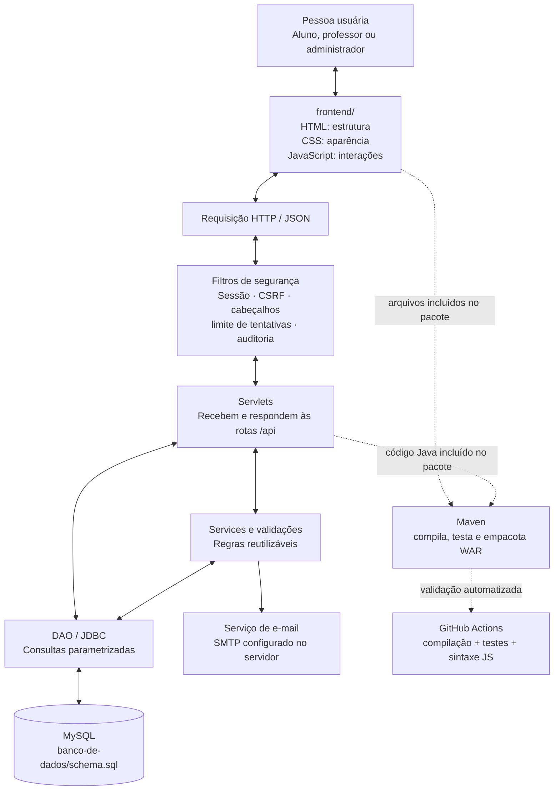
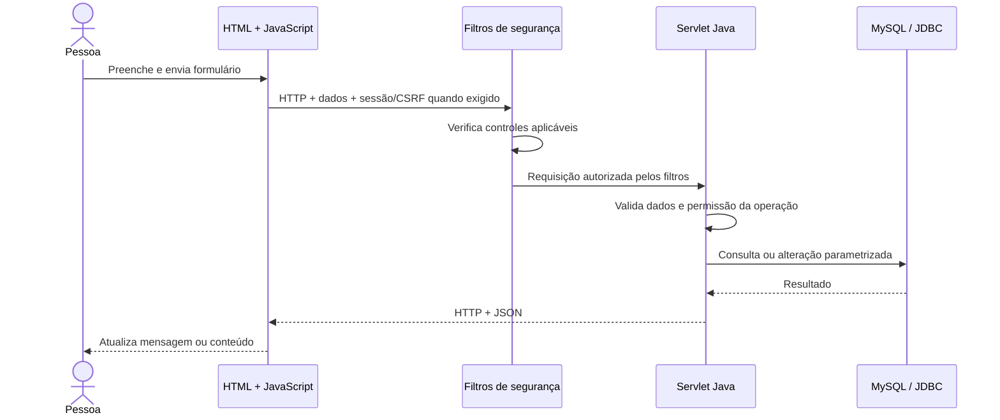
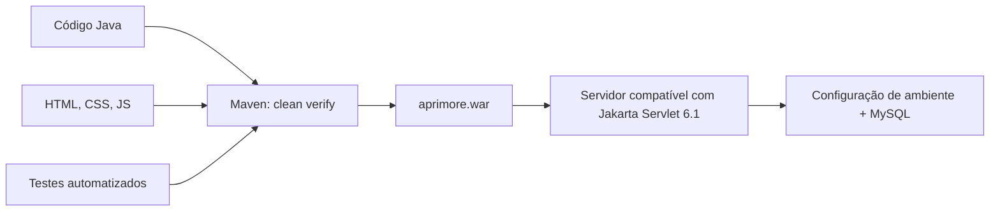

# Mapa visual do Aprimore

Este documento é o **mapa do projeto**. Use-o para entender como as pastas se conectam antes de alterar código.

## 1. Visão de cima



**Leia o fluxo assim:** a interface não deve acessar o MySQL diretamente. Ela envia uma requisição; o Java verifica sessão e permissões, aplica as regras e consulta o banco. O servidor devolve uma resposta para o JavaScript atualizar a tela.

## 2. Mapa de pastas

```text
aprimore7.0/
│
├── frontend/                     O QUE A PESSOA VÊ
│   ├── index.html                Entrada, login, cadastro e recuperação
│   ├── dashboard.html            Estrutura do painel autenticado
│   └── assets/
│       ├── css/style.css         Cores, layout, estados e responsividade
│       └── js/
│           ├── app.js            Interações da página de autenticação
│           ├── dashboard.js      Dados e ações do painel escolar
│           ├── jogos.js          Catálogo e regras dos jogos educativos
│           └── recursos.js       Calendário, avisos e acessibilidade
│
├── backend/                      O QUE ACONTECE NO SERVIDOR
│   ├── pom.xml                   Versões, dependências, testes e empacotamento
│   └── src/
│       ├── main/java/br/com/aprimore/
│       │   ├── config/           Conexões e configuração compartilhada
│       │   ├── dao/              Leitura e gravação no banco
│       │   ├── model/            Objetos que representam dados
│       │   ├── security/         Filtros e controles de segurança
│       │   ├── service/          Serviços reutilizáveis
│       │   ├── servlet/          Endpoints HTTP da aplicação
│       │   └── util/             Utilitários comuns
│       ├── main/webapp/WEB-INF/
│       │   └── web.xml           Configuração web e sessão
│       └── test/java/            Testes automatizados Java
│
├── banco-de-dados/
│   ├── schema.sql                Banco, tabelas, chaves e índices
│   └── usuario-aplicacao.sql     Exemplo de usuário MySQL com privilégios limitados
│
├── documentacao/                 Como entender, operar e evoluir o projeto
├── .github/workflows/java.yml    Verificações automáticas a cada mudança
├── .env.example                  Nomes das configurações necessárias
├── .gitignore                    Arquivos que não devem ir para o Git
└── README.md                     Porta de entrada para o repositório
```

## 3. Qual arquivo devo abrir?

| Se você quer… | Comece aqui | Por quê |
|---|---|---|
| Mudar o visual ou os estilos | `frontend/assets/css/style.css` | Regras visuais compartilhadas |
| Mudar login ou cadastro | `frontend/index.html` e `frontend/assets/js/app.js` | Formulário e comportamento no navegador |
| Mudar o painel e formulários escolares | `frontend/dashboard.html` e `frontend/assets/js/dashboard.js` | Estrutura e ações do painel |
| Mudar jogos | `frontend/assets/js/jogos.js` | Catálogo, regras e pontuação dos jogos |
| Mudar calendário ou acessibilidade | `frontend/assets/js/recursos.js` | Recursos de apoio do painel |
| Criar ou alterar uma rota | Servlet relacionado em `backend/src/main/java/br/com/aprimore/servlet/` | Recebe a requisição HTTP |
| Mudar regras de segurança | `backend/src/main/java/br/com/aprimore/security/` | Filtros aplicados às requisições |
| Alterar conexão com MySQL | `backend/src/main/java/br/com/aprimore/config/Database.java` | Cria conexões com o banco |
| Alterar tabelas ou índices | `banco-de-dados/schema.sql` | Estrutura persistida dos dados |
| Adicionar biblioteca Java | `backend/pom.xml` | Dependências e compilação Maven |
| Verificar se passou nos testes | GitHub → Actions | Resultado do workflow automatizado |

## 4. Caminho de uma requisição



Os filtros não substituem a autorização dentro das rotas: cada operação ainda precisa verificar se a conta pode acessar aquele recurso. Nunca confie apenas em botões escondidos na interface.

## 5. Onde ficam as responsabilidades do backend?

- **Servlet:** entende a requisição HTTP, chama as regras necessárias e monta a resposta.
- **Service:** concentra uma operação de negócio reutilizável, quando a regra precisa ser separada do endpoint.
- **DAO:** conversa com o banco por JDBC. Use parâmetros SQL; não concatene valores recebidos do usuário em consultas.
- **Model:** representa dados que circulam entre as partes.
- **Config:** concentra configuração técnica, como conexão com o banco.
- **Security:** filtros e controles transversais aplicados a requisições.
- **Util:** funções genéricas que não pertencem a uma regra específica.

Não crie classes só para aumentar a quantidade de pastas. Separe uma responsabilidade quando isso reduzir duplicação ou tornar uma regra mais fácil de testar.

## 6. Como o projeto vira uma aplicação executável?



Comando a partir da raiz:

```bash
cd backend
mvn clean verify
```

O comando valida o código e gera o WAR; ele não cria sozinho o banco nem configura o servidor. Consulte o [README](../README.md) para os requisitos de execução.

## 7. Regras para manter a organização

1. Mantenha a interface em HTML, CSS e JavaScript puro; regras de negócio e segredos ficam no servidor.
2. Não coloque senhas, tokens ou chaves reais no Git.
3. Ao criar uma rota, documente método, caminho, perfil permitido, entrada, resposta e erros esperados.
4. Ao alterar o banco, atualize o SQL e confira todos os Servlets/DAOs que usam a tabela.
5. Ao corrigir um bug, adicione um teste reproduzível sempre que possível.
6. Não diga que uma função está validada só porque o projeto compilou. Testes com MySQL, servidor Servlet e SMTP reais são uma etapa separada.
7. Preserve nomes em português e padrões de nomenclatura consistentes com o restante do projeto.
